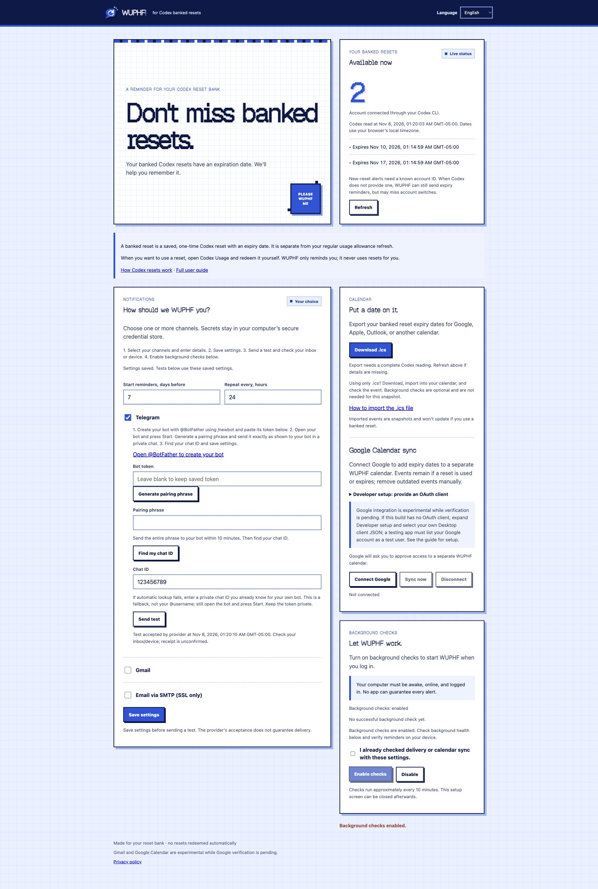

# WUPHF user guide: reminders for banked Codex resets

**WUPHF helps you remember to use an available banked Codex reset before it expires.** It runs on your computer and can notify your own email, Telegram, or calendar. Pick one option or combine several. WUPHF never redeems a reset for you.

This guide describes **v0.1.0-beta.2**. Button names below use the English interface. The app also includes Spanish, German, Portuguese, French, Japanese, Korean and Simplified Chinese.

**Start here:** [Let Codex help install it](../README.md#let-codex-set-it-up-for-you), or follow [manual installation](#2-install-on-your-computer). Already installed? Jump to [connect your accounts](#4-connect-only-the-options-you-want) or [fix a problem](#9-fix-a-problem).

**Your setup route:** install → check your reset status → choose one or several options below. Read only the sections you need.

- **Gmail, SMTP or Telegram:** connect → save → send a test → confirm receipt → enable background checks.
- **Google Calendar sync:** connect → save → sync → check the calendar events → enable background checks. No email or Telegram channel is required.
- **ICS only:** export → import → check the calendar events and alerts. Background checks are unnecessary.

## Contents

1. [Understand what WUPHF watches](#1-understand-what-wuphf-watches)
2. [Install on your computer](#2-install-on-your-computer)
3. [Read your reset status and choose reminder times](#3-read-your-reset-status-and-choose-reminder-times)
4. [Connect only the options you want](#4-connect-only-the-options-you-want)
5. [Enable background checks](#5-enable-background-checks)
6. [Check that setup is complete](#6-check-that-setup-is-complete)
7. [Use WUPHF day to day](#7-use-wuphf-day-to-day)
8. [Change, upgrade or remove your installation](#8-change-upgrade-or-remove-your-installation)
9. [Fix a problem](#9-fix-a-problem)
10. [Privacy, costs and limits](#10-privacy-costs-and-limits)

## 1. Understand what WUPHF watches

A **banked reset** is a one-time reset granted to your Codex account that you can save and use before its expiry. Receiving one does not immediately refill your usage allowance. Availability and expiry depend on the offer and your account. Your usual scheduled usage refresh is a different event. [OpenAI's explanation of resets](https://help.openai.com/en/articles/20001498-how-resets-work-in-codex).

| What you want to know | Is this WUPHF's purpose? |
| --- | --- |
| Do I have unused banked resets, and when do they expire? | **Yes.** WUPHF reads the details available through your signed-in Codex CLI. |
| Can I get reminders before those expiry dates? | **Yes**, when Codex supplies the necessary details and your selected channel works. |
| When does my normal five-hour or weekly usage allowance refresh? | No. Check Codex's own Usage screen. |
| Can this grant, buy, recover or automatically use a reset? | No. WUPHF only tracks and reminds. |

**Who it is for:** Codex users who have banked resets, or want to watch for future ones, and can run WUPHF on a desktop or laptop. It works with your own ChatGPT sign-in and your own destinations; you never need the maintainer's email or Telegram account.

**No reset available?** You can still set up and test notifications. A complete reading of `0` means none were reported at that check. A missing count or incomplete reading means WUPHF cannot tell; it does not prove that your balance is empty. WUPHF cannot promise that your account will receive a reset.

## 2. Install on your computer

### Choose the shortest path for you

Use the [copy-and-paste Codex setup prompt](../README.md#let-codex-set-it-up-for-you) in a local Codex session if you want help doing the work. You still choose your channels and complete private credential entry and required approvals. For manual setup, continue below.

You need an internet connection, the **Codex CLI signed in with ChatGPT**, and one of the supported computers. Downloaded WUPHF packages include Python. The Codex desktop app alone does not satisfy the CLI requirement.

### Sign in to Codex once

1. Install the [official Codex CLI](https://developers.openai.com/codex/cli/) if you do not already have it.
2. Open Terminal on macOS/Linux, or PowerShell on Windows. Run `codex --version` to check that it is available.
3. Run `codex` and use **Sign in with ChatGPT** for the account you want WUPHF to monitor. An existing working CLI sign-in can be reused.

Do not copy your ChatGPT password or Codex authentication files into WUPHF or an assistant chat.

### Download, extract and open WUPHF

Get your archive and `SHA256SUMS` from the [official beta release](https://github.com/Robertzu43/WUPHF-my-banked-resets/releases/tag/v0.1.0-beta.2). **Check the download before extracting or opening it**, using the steps below. Then keep the **entire extracted WUPHF folder**, including `_internal`. Moving only the executable breaks the package.

<details>
<summary>Check the download's SHA-256 checksum</summary>

Before extracting, open a terminal in the folder containing the archive. Run the command for your system, replacing `ARCHIVE_NAME` with the downloaded filename, and compare the resulting hash with that filename's line in the release's `SHA256SUMS`.

```sh
# macOS
shasum -a 256 "ARCHIVE_NAME"
# Linux
sha256sum "ARCHIVE_NAME"
```

```powershell
# Windows PowerShell
Get-FileHash -Algorithm SHA256 "ARCHIVE_NAME"
```

The full hash must match (letter case does not matter). If it differs, stop and download the archive again from the official release. A matching checksum checks download integrity; it does not substitute for trusting the publisher.

</details>

| Computer | Release archive | Where to put it and how to open it |
| --- | --- | --- |
| Apple silicon Mac, M1 or newer | `wuphf-0.1.0-beta.2-macos-arm64-unsigned.tar.gz` | Extract it. In Finder, choose **Go → Go to Folder**, enter `~/Library/Application Support/`, and move the extracted `WUPHF` folder there. Open `Start WUPHF.command`, or use the Terminal command below. |
| Windows 10 or newer, x64 | `wuphf-0.1.0-beta.2-windows-x86_64-unsigned.zip` | Use **Extract All**, put the whole `WUPHF` folder in a permanent location you own, then double-click `WUPHF.exe`. Do not run it inside the ZIP. |
| Linux x64 desktop, Ubuntu 24.04 build | `wuphf-0.1.0-beta.2-linux-x86_64-unsigned.tar.gz` | Extract it into a permanent folder. Use `Start WUPHF.sh` from a terminal in that folder; your file manager may also offer Run. If needed, run `sh "Start WUPHF.sh"`. |

### Optional automatic placement

Instead of moving the extracted folder yourself, open a terminal in that folder and run `./WUPHF --install` on Mac/Linux, or `.\WUPHF.exe --install` in Windows PowerShell. This local command uses the Python already in the package. It makes a complete copy in your user installation folder, then prints the installed version and reopen path. It does not sign you in, connect accounts or start background jobs.

The defaults are `~/Library/Application Support/WUPHF` on Mac, `%LOCALAPPDATA%\WUPHF` on Windows, and `~/.local/opt/WUPHF` on Linux. Launch the installed copy using its `Start WUPHF.command`, `WUPHF.exe`, or `Start WUPHF.sh` entry. The original extracted folder can be removed after you verify the installed copy opens.

An identical existing installation is a safe no-op. A different existing folder is preserved and the command stops: follow the [upgrade steps](#8-change-upgrade-or-remove-your-installation) before replacing it. OS approval may still be required for an unsigned download. Source installs use the separate [Python setup](../README.md#run-from-source); `--install` is for complete binary packages.

On macOS, open Terminal and paste:

```sh
cd "$HOME/Library/Application Support/WUPHF"
./WUPHF
```

On macOS, background jobs need WUPHF and Codex outside Documents, Desktop and Downloads. Source installations also need Python outside those protected locations. Linux needs a graphical session, an unlocked Secret Service credential store, and a working systemd user service. The Linux build may not run on older distributions. Intel Macs and other unlisted architectures have no matching packaged download; see [source installation](../README.md#run-from-source) and its compatibility limits.

**If macOS says “WUPHF Not Opened”:** this beta is not Apple-notarized. Select **Done**. If you have checked the source and choose to trust it, use **System Settings → Privacy & Security → Open Anyway**, then follow the confirmation. See [Apple's instructions](https://support.apple.com/en-us/102445). Do not turn off Gatekeeper globally. Windows may also display a warning for this unsigned beta; follow your computer's security policy rather than disabling protections.

**You are ready for setup when:** WUPHF opens its local page in your browser. Keep its process/window running while configuring it. The `127.0.0.1` address means the page is on this computer; it is not a public website you can open on your phone.

## 3. Read your reset status and choose reminder times

Click **Refresh** and check that Codex is signed into the account you intended.

The dates on this page use your browser's local time zone; their display format follows the selected language. Check the date and time against Codex before relying on an expiry, especially after travel or a time-zone change.

<details>
<summary>See the setup screen and where the controls are</summary>



Example of the actual interface with **fictional reset data**. This is not a connected user's account or proof of successful delivery. Your counts and dates will differ. The reset status is at the top; notification settings, calendars and background controls follow below.

</details>

| What you see | What it means / what to do |
| --- | --- |
| A count and expiry dates, with complete data | WUPHF can use those known dates for reminders. |
| `0` with complete data | No banked resets were reported. You can still send channel tests. |
| `?`, missing dates, or an incomplete-data message | Some information is unavailable. Refresh and check Codex's own Usage screen. WUPHF will not guess dates or treat missing data as zero. |
| An account or connection error | Fix the displayed issue before relying on reminder checks. |

Choose your interface language, then set:

| Setting | What it controls | Starting value |
| --- | --- | --- |
| **Start reminders, days before** | How far ahead of a known expiry email/Telegram reminders begin. | `7` days |
| **Repeat every, hours** | Minimum interval between repeat expiry reminders for a reset on a channel. | `24` hours |

Click **Save settings** after changing these values or channel details. Tests are unavailable while changes are unsaved; a failed save keeps that protection in place. Use positive values; the UI accepts fractional days and hours. Calendar alarms have their own behavior described below—these two fields do not change them.

**Where to save:** the **Save settings** button is below the notification channel forms. If you expanded several channels, scroll past those forms to find it. **Send test uses saved settings**, so save first, then return to your selected channel's test button.

**Example:** with a hypothetical expiry of November 20 at 18:00, `7` days starts the reminder window on November 13 at 18:00. An awake, online computer checks approximately every 10 minutes, so delivery is not exact to the minute. `24` hours repeats after a successful reminder while the reset remains available and unexpired. A separate newly detected reset notice can arrive outside this expiry window when account identity and comparison data are available. The first reading establishes a baseline; do not expect an arrival notice just because you installed WUPHF.

## 4. Connect only the options you want

**One working channel is enough.** Add others later if useful.

| Choose | Best fit | Setup requirement |
| --- | --- | --- |
| [Calendar file (ICS)](#calendar-file-ics) | You want expiry dates without authorizing a provider in WUPHF. | Import a file; repeat manually when dates change. |
| [Telegram](#telegram) | You already use Telegram and want recurring phone messages. | Create your own bot once and pair its private chat. |
| [Gmail](#gmail) | You want reminders in your Gmail inbox. | Approve your own Google account; Google's restrictions may affect access. |
| [Other email (SMTP)](#other-email-smtp) | Your provider supports SMTP over SSL. | Enter the provider's settings and an app password/supported credential. |
| [Google Calendar sync](#google-calendar-sync) | You want WUPHF to add/update expiry dates automatically. | Authorize Google separately and enable background checks. |

In the app, **Gmail** means Google sign-in; **Email via SMTP (SSL only)** means manual SMTP settings. Choose one for your email reminders unless you intentionally want both to send. The Email form's example `smtp.gmail.com` is not a requirement to use Gmail—replace it with your provider's server.

### Telegram

1. Open the official [@BotFather](https://t.me/BotFather) chat in Telegram and send `/newbot`.
2. Choose a display name, such as **My WUPHF reminders**, then a unique bot username ending in `bot`. If a username is taken, choose another. BotFather gives you a bot token—keep it private. [Telegram's bot creation instructions](https://core.telegram.org/bots/features#creating-a-new-bot).
3. In WUPHF, enable **Telegram** and paste that token into its token field. This is your bot's token, not your Telegram login code.
4. Open the chat with **your newly created bot** and tap **Start** (or send `/start`).
5. In WUPHF, click **Generate pairing phrase**. Send the exact phrase to your bot's private chat within 10 minutes. Send it to your bot, **not BotFather**.
6. Click **Find my chat ID**, then **Save settings** and **Send test** for Telegram.

**Success looks like:** a WUPHF test message appears in your bot's chat. The on-screen test status records provider acceptance for this session; check the actual chat to confirm receipt. Enable Telegram notifications on your phone if you want a phone alert. Repeat messages come from your own bot; the maintainer has no access to it.

If pairing expires, generate a new phrase. A bot already used by another service or webhook can prevent lookup; a dedicated bot is simpler. The manual chat-ID field is an advanced fallback, not your `@username`. Never paste your token into a public URL, issue or assistant chat.

### Gmail

1. Enable **Gmail** and enter your Gmail address.
2. Click **Connect Gmail**, select that same Google account, and review the send-only permission. Inbox reading is not requested.
3. Finish the authorization in a browser on **the computer running WUPHF**, keeping WUPHF open. Return when the callback says the authorization response was received, and check that WUPHF itself reports a saved connection.
4. Click **Save settings**, then **Send test** for Gmail. Check the inbox and spam folder.

**Success looks like:** WUPHF shows the connection and the test arrives in your inbox. A callback page or provider acceptance message alone is not proof of delivery.

The bundled Google registration identifies WUPHF; it does **not** send from the maintainer's email. You authorize your own account. Google's review is pending, so warnings, account restrictions or access limits can prevent connection. If blocked, follow the displayed error, choose another channel, or use an optional own registration under **Developer setup**. Regular users do not need a Google Cloud project for the bundled path. See [Google registration details](google-production.md); an own registration still has to follow Google's policies.

Old authorization links expire. For a timeout, `400` error or failed local callback, return to WUPHF and start a fresh connection. Do not reuse a link from chat history or finish on a phone.

### Other email (SMTP)

SMTP is your email provider's outgoing mail service. Get the values below from that provider's instructions; different providers have different requirements.

| Field | What to enter |
| --- | --- |
| Server/host | The provider's SMTP SSL hostname. |
| Port | Its SSL port, commonly `465`. This beta does not support STARTTLS-only services, commonly using `587`. |
| Username | The provider's required login, often your full email address. |
| Sender / From | An address your provider allows that account to send from. |
| Recipient / To | Your destination for reminders. |
| Password | The provider's app password or supported SMTP credential, entered directly in WUPHF. |

Enable **Email via SMTP (SSL only)**, enter these details, **Save settings**, then **Send test**. Confirm receipt. A normal account password may not work, especially with two-factor authentication; follow your provider's rules. WUPHF cannot create an app password for you. If these settings are unfamiliar, Telegram or ICS avoids SMTP setup.

### Calendar file (ICS)

1. With complete reset data, click **Download .ics**. The file contains currently available resets with known future expiries.
2. Import it into your calendar using one of the paths below. A separate calendar named **WUPHF resets** makes these events easier to manage.
3. Open an imported event and verify its expiry time, time zone and alert settings.

| Calendar | Import path |
| --- | --- |
| Google Calendar, on a computer | **Settings → Import & export → Select file from your computer**; choose the ICS file, destination calendar, then **Import**. [Google instructions](https://support.google.com/calendar/answer/37118?hl=en). |
| Apple Calendar, on Mac | Use **File → Import**, select the ICS file and choose a destination calendar. [Apple instructions](https://support.apple.com/guide/calendar/import-or-export-calendars-icl1023/mac). |
| Outlook.com / Outlook on the web | Open Calendar, **Add calendar → Upload from file**, choose the ICS file and destination calendar, then import. [Microsoft instructions](https://support.microsoft.com/en-us/outlook/import-or-subscribe-to-a-calendar-in-outlook-com-or-outlook-on-the-web). |
| Another calendar app | Look for **Import** or **Import ICS/iCalendar** in that app's help. |

**Success looks like:** each expected expiry appears on the correct date in your calendar. If no future known expiries are available, an export can have no events.

This is a **one-time snapshot**, not a subscription. Export/import again when resets change; re-importing can create duplicates. WUPHF includes an alert request for **one day before expiry**, but calendar apps can change or ignore imported alarms. Verify the resulting event instead of assuming a phone notification will appear. Calendar times are stored in UTC and displayed according to your calendar's time zone.

You can close WUPHF after importing. Your calendar handles imported alerts; WUPHF background checks are unnecessary for ICS alone.

### Google Calendar sync

Sync requires Codex to supply a stable account identifier. If that information is unavailable, WUPHF pauses sync; email, Telegram and ICS remain available. A Calendar connection made before account binding must be disconnected and reconnected once, creating a separate WUPHF calendar while keeping the old remote calendar and its events. Switching Codex accounts also requires a new Calendar connection.

1. In the calendar section, click **Connect Google**, select your Google account on the same computer, and review the separate calendar permission.
2. Return to WUPHF, confirm the saved connection, and click **Sync now**.
3. Open Google Calendar and look for WUPHF's separate calendar. Check an expiry event against the available reset dates. With no future known expiry, there may be no events to display.
4. Enable background checks to update events as WUPHF receives complete data.

WUPHF requests access to calendars it creates, not your unrelated calendars. Gmail and Calendar authorize independently; you may use either one alone. The bundled registration is selected automatically. An optional Desktop client JSON can be selected under **Developer setup**; its project needs the Calendar API enabled. See [Google registration details](google-production.md).

Synced events request a popup **24 hours before expiry**, independent of your email/Telegram reminder frequency. Check Google Calendar and phone notification settings. Events are created or updated, but old events are not automatically removed when a reset disappears or is used. Disconnecting removes local authorization, not the remote calendar; reconnecting can create another WUPHF calendar. Remove stale events/calendars manually if needed. Avoid importing ICS for the same dates into the synced calendar unless you want duplicate entries.

### Existing ntfy installations

Existing ntfy configurations remain supported for their owners. This beta's new-user setup focuses on the options above and does not provide a new ntfy connection flow.

## 5. Enable background checks

For email, Telegram or automatic Google Calendar sync:

1. Save settings and complete the relevant test/sync first.
2. Under **Background checks**, follow the displayed next step and click **Enable checks**. If you already verified delivery or Calendar sync with these saved settings, you can acknowledge that instead of sending another test. This acknowledgement is your confirmation, not a new provider check.
3. Confirm the scheduler is enabled and that the **last successful check** updates. Allow about 10 minutes for the regular cycle. Inspect any displayed error or failed channel.
4. Once verified, you can close the setup page and its process/window. Reopen WUPHF when you need it.

WUPHF installs a background job for your user account: launchd on macOS, Task Scheduler on Windows, or systemd on Linux. It checks approximately every 10 minutes. **Enabled** means the job is installed; a recent successful check and your channel tests give separate evidence that it works.

The computer must remain **awake, online and logged in**. WUPHF does not keep it awake or change power settings. While it sleeps or is offline, new checks cannot deliver alerts. When checks resume, still-valid reminders can be sent; WUPHF cannot recover an expired reset. Imported/synced calendar events may still alert through your calendar provider or phone.

## 6. Check that setup is complete

- [ ] WUPHF reads the intended Codex account without an error. A complete zero balance is valid; unknown data needs investigation.
- [ ] Your chosen reminder times and language are saved.
- [ ] Every enabled email/Telegram channel delivered a test you actually received.
- [ ] If using a calendar, expected events and their alerts/time zones are checked, or no future known expiries are currently available.
- [ ] For recurring reminders/sync, background checks are enabled and the last successful check updates.
- [ ] You know where the app is installed and how to reopen it.

You do not need to connect every channel. A test checks the connection, not future availability of your computer, Codex or the provider.

## 7. Use WUPHF day to day

**When a reminder arrives:** open Codex and review the available reset, its expiry and the limits it covers. In the desktop app, use **Settings → Usage & billing**; in Codex CLI, `/usage` may offer **Redeem reset**. Use the available reset controls only if you decide to redeem it. OpenAI determines when redemption is allowed; WUPHF cannot override eligibility. See [OpenAI's reset instructions](https://help.openai.com/en/articles/20001498-how-resets-work-in-codex).

**To reopen settings:** launch WUPHF from its installed folder again. Use the new browser page it opens. An old `127.0.0.1` bookmark may have an expired port/session.

**After using a reset:** click **Refresh** or allow a background check. WUPHF uses the current complete data to decide further reminders. A disappearance does not itself establish whether a reset was used or expired. Check Codex for that history; clean up old calendar events yourself.

**After switching Codex accounts/workspaces:** reopen WUPHF, refresh, and review the destinations before enabling reminders for the new account. Only the current CLI account is monitored. If Codex omits a stable account identifier, WUPHF cannot reliably distinguish switches or send new-reset notices; known-expiry reminders may still run. Do not rely on WUPHF as a multi-account dashboard.

**To change the frequency or a channel:** edit settings, save, and test the changed channel. There are no quiet-hour or snooze controls in this beta. Disable a channel and save to stop future sends through it; disable background checks to pause all scheduled WUPHF work.

## 8. Change, upgrade or remove your installation

| Task | Steps |
| --- | --- |
| Change a saved token/password | Enter the replacement directly in the relevant WUPHF field, save, then test. An empty secret field can mean “keep the saved value”; it is not proof that no credential exists. |
| Move or upgrade WUPHF | Disable background checks, close WUPHF, then move/replace the **whole application folder**. Keep your data and OS credentials. Reopen, review and test, then enable checks from the new location. Do not run two copies against the same settings. |
| Stop scheduled reminders | Click **Disable** under Background checks. Saved settings remain. A check already running may finish. |
| Disconnect Google | Use the integration's **Disconnect** button. For remote revocation, remove its access in [Google account connections](https://myaccount.google.com/connections). Remote calendars remain until you remove them. |
| Uninstall | Disable checks first, disconnect integrations if desired, close WUPHF and delete its application folder. |
| Erase saved data too | Remove WUPHF credential entries in macOS Keychain, Windows Credential Manager or Linux Secret Service. Delete `~/.local/share/wuphf-resets/`; on Windows this is `%USERPROFILE%\.local\share\wuphf-resets\`. Remove remote calendar events separately. |

If you used `--install`, a different installed version is preserved rather than overwritten. Disable checks and close the old app, retain its complete folder as a backup outside the final `WUPHF` destination, then run the new verified bundle's `--install` again. Test the new installed copy before removing the backup. Keep the existing local data and OS credentials; do not move a source virtual environment as if it were a binary bundle.

To find saved credentials, search your OS credential manager for the service name **WUPHF My Resets**. Entries can include `telegram.token`, `email.password`, `gmail.refresh_token` and `google.refresh_token`, plus their client-secret entries or a legacy `ntfy.token`. Remove only WUPHF entries; do not delete your Codex sign-in.

Disabling a channel or deleting the application does not automatically erase its saved credentials. Removing local files also does not revoke a provider's grant or delete messages already delivered.

## 9. Fix a problem

| Problem | First action | Next action if it persists |
| --- | --- | --- |
| App will not open / missing `_internal` | Extract the entire archive, then open the executable from that folder. | Check OS/architecture compatibility and the [opening instructions](#download-extract-and-open-wuphf). |
| Browser says forbidden or cannot connect | Reopen WUPHF and use the fresh page it opens. | Keep its process running; do not reuse an old local URL or open it from another device. |
| Codex cannot be found | Confirm `codex --version` works in the terminal. | Reopen WUPHF after installing/signing in; for Mac background use, check installation paths. |
| Missing count, expiry, or incomplete data | Refresh and compare with Codex's own Usage screen for the same account/workspace. | Check CLI sign-in/version. Missing data cannot be repaired by changing reminder frequency. |
| Google callback or `400` error | Start a new connection from WUPHF on the same computer. | Keep WUPHF open and inspect the exact error; stale links, policy restrictions and account limits need different fixes. Never share callback codes. |
| Google connection is blocked or revoked | Read the Google error and reconnect if allowed. | Use another channel or ICS while resolving provider access. Production status does not guarantee permanent tokens or Google verification. |
| Telegram cannot find my chat | Start your bot, generate a fresh phrase and send it to that bot's private chat. | Ensure another service is not consuming that bot's updates; prefer a dedicated bot. |
| Test accepted but no message | Check the selected recipient, spam or bot chat, then notification settings. | A provider success response is not proof of receipt. Review WUPHF's error and credentials; avoid repeated rapid tests. |
| SMTP fails | Verify the host, SSL port, account and app password with the provider. | STARTTLS-only connections are not supported. Choose another channel if needed. |
| Background enabled, but no recent successful check | Confirm the computer is awake, online and logged in; inspect the error. | On Mac, check WUPHF/Python/Codex paths. On Linux, check the unlocked keyring and systemd user session. |
| No reminder despite a working test | Check the known expiry, start-days value, last successful check and failed-channel status. | The reset may be outside the window, already reminded recently, unavailable or missing reliable details. Tests do not require an actual banked reset. |
| Calendar date/alert looks wrong | Check the calendar's time zone and event notification settings. | ICS is static; calendar apps may ignore imported alarms. Remove stale/duplicate events and re-export or sync as appropriate. |

For help, [open an issue](https://github.com/Robertzu43/WUPHF-my-banked-resets/issues) with your OS/architecture, WUPHF version, chosen integration, the step that failed and a **redacted** error. Never attach your data folder, raw Codex authentication/reset responses, bot tokens, passwords, OAuth callback URLs or private calendar data. A screenshot should hide addresses and other personal details you do not want public.

<details>
<summary>Codex was installed, but WUPHF still cannot find it</summary>

Close and reopen your terminal, then try `codex --version` again. If the command is still missing, complete the [official CLI installation instructions](https://developers.openai.com/codex/cli/) for your system. Once it works, close and reopen WUPHF so it can pick up the updated environment.

To locate the CLI, run `command -v codex` on macOS/Linux or `Get-Command codex` in PowerShell. On Mac, if that installation (or the target of a symbolic link) lives in Documents, Desktop or Downloads, reinstall it in a supported location outside those folders using its installer/package manager. Moving a single executable can break its dependencies. After relocating either app, disable and re-enable WUPHF background checks from the new installation.

For source installation only, the launchers check available Python versions and any existing `.venv`. If an old or broken environment is reported, retain it as a backup in place under a different name, then restart the launcher to create a fresh environment in the final source folder. You can set `WUPHF_PYTHON` to an already installed 3.11+ executable path; it must be one executable, not a command with extra arguments. WUPHF does not install a new Python runtime or replace system Python for you.

On Linux, run WUPHF from your logged-in graphical desktop with its credential store unlocked. A remote shell or headless session may not provide the keyring and user services the desktop package needs.

</details>

## 10. Privacy, costs and limits

WUPHF is free, open-source software under the [MIT License](../LICENSE). It has no WUPHF subscription, central account database or telemetry. Provider limits, internet access and your computer's operating costs still apply. WUPHF does not purchase anything or require API credits for reading your signed-in Codex account.

Secrets use your OS credential store. Settings, reset identifiers and reminder history stay in the local data folder described above. Selected providers receive the messages/events needed to deliver their features. The local browser setup page is not a remotely accessible dashboard. See the [privacy policy](https://robertzu43.github.io/WUPHF-my-banked-resets/privacy.html).

This beta's installed-app, provider and long-running checks have different coverage. The [release evidence](release-readiness.md) records what was tested and what remains unverified. This guide's provider import steps are documented workflows, not a claim that every calendar app or computer has been tested. WUPHF is independent of OpenAI and *The Office*. It helps you remember; it cannot guarantee every alert or extend a reset's expiry.
